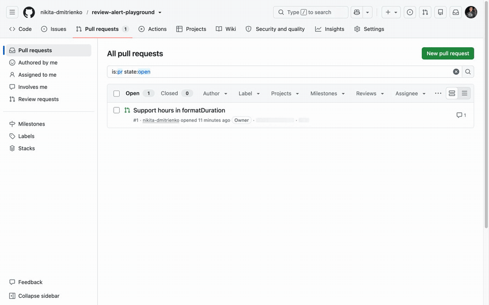

# Unsubmitted Review Alert for GitHub



You start a review on a pull request, leave a few comments and move on without clicking "Submit review".
Those comments stay pending. Nobody sees them but you.

This Chrome extension reminds you. On a pull request with an unsubmitted review it:

- shows a bar with the number of pending comments and a "Finish review" button
- turns the tab icon into a red warning sign and adds "⚠ PENDING REVIEW" to the tab title
- asks before you leave the pull request, close the tab or reload it

It follows your GitHub theme. The bar works with the keyboard and is labelled for screen readers.

It runs only on github.com and asks for no other access. It makes no network requests and stores nothing.
[Privacy policy](https://nikita-dmitrienko.github.io/unsubmitted-review-alert/privacy-policy.html).

## Install

Not in the Chrome Web Store yet. To try it now:

1. Download or clone this repository.
2. Open `chrome://extensions` and turn on Developer mode.
3. Click "Load unpacked" and pick the `extension` folder.

## Develop

```bash
npm install
npx playwright install chromium
npm test           # end-to-end tests with the real extension loaded
npm run package    # zip for the Chrome Web Store, in dist/
```

## License

[MIT](LICENSE)
